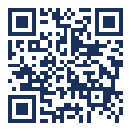

# Free My ID: fridge card

*Print at 100%, cut along the line, and stick it on the fridge or next to the computer. Fill in the helper's name and number by hand. Don't print personal details on it.*

<!-- QR points to the site; switch it to the video URL once the walkthrough is published. Regenerate: segno.make(URL, error="m").save("docs/assets/qr-site.svg", scale=8, border=2, dark="#1b2f5b") -->

---

## 🛡️ Free My ID

### It checks for you every day.
You don't need to do anything. It works quietly in the background.

### A card with a big button means a website needs you.
Click the button and follow the steps. If you see **"I'm not a robot"**, tick it and press **Submit** yourself.

### It will NEVER ask for your Social Security number, bank or card details, or your everyday email password.
If something asks for those, **it isn't us. Stop and call your helper.**

**My helper:** ______________________  **Phone:** ______________________

*Scan with a phone camera to watch a short how-to video.*

---
