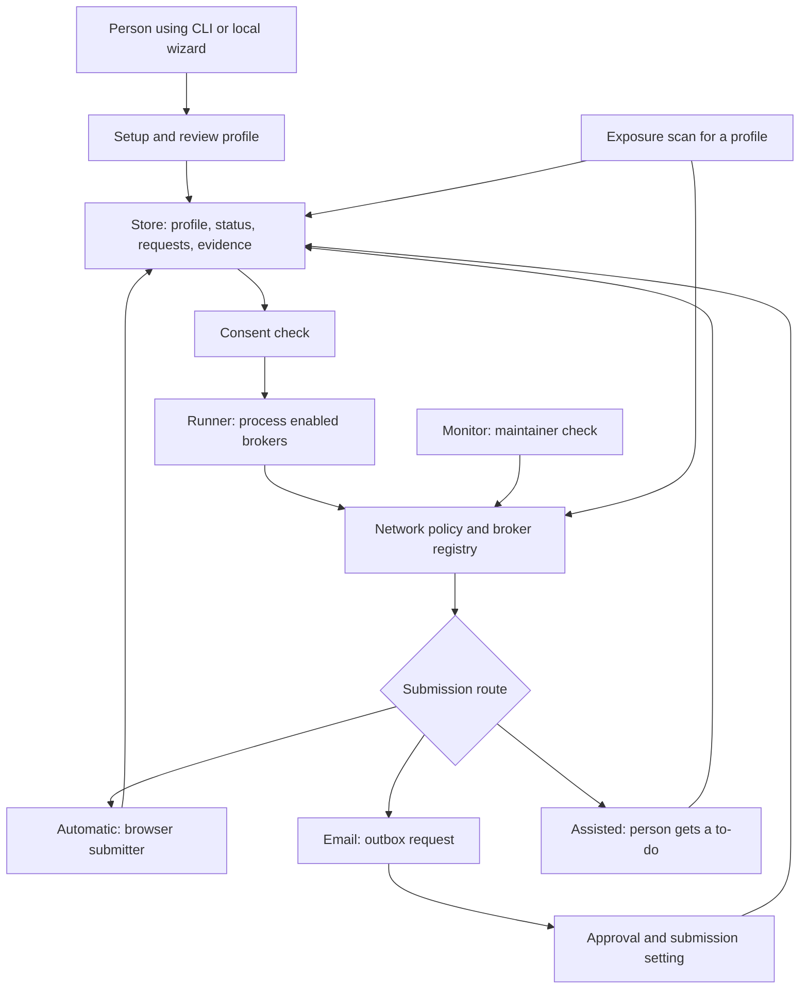

# Free My ID architecture map

This guide is a short map for contributors. Source references use repository-relative paths and line numbers. The modules named below describe the current code in this worktree; check the cited lines if the code changes.

## Main path through the app

The `freemyid` command is registered to `freemyid.cli:app` (`pyproject.toml:57-58`). The CLI can start the local wizard or run setup in the terminal (`src/freemyid/cli.py:147-176`). The wizard is a FastAPI app bound to loopback (`src/freemyid/wizard/server.py:908-920,961-983`). When the wizard reaches Finish, it validates and saves the draft through the Store, then starts the configured follow-up (`src/freemyid/wizard/server.py:877-903`; `src/freemyid/wizard/draft.py:577-603`).

The runner checks each profile's consent before processing it, then visits enabled brokers one at a time (`src/freemyid/engine/runner.py:400-413,426-459`). For each broker it determines a tier, scans when the broker is eligible, and submits only when the state allows it (`src/freemyid/engine/runner.py:488-543`). The consent rules are centralized in `consent_ok` (`src/freemyid/consent.py:55-82`).

## Module map

| Area | What it does | Source |
|---|---|---|
| CLI and configuration | Exposes the `freemyid` command; the CLI delegates app settings to `config.py`. | `pyproject.toml:57-58`; `src/freemyid/cli.py:1-22,147-176`; `src/freemyid/config.py:1-13,16-38` |
| Wizard and dashboard | Accepts setup and settings forms, saves a profile, and shows its status, to-dos and queued requests. | `src/freemyid/wizard/server.py:139-151,223-243,569-587,877-903`; `src/freemyid/wizard/draft.py:577-603` |
| Runner | Checks consent, selects enabled brokers, updates status, and asks a submitter to handle eligible requests. | `src/freemyid/engine/runner.py:400-413,426-459,488-543,672-715` |
| Tier selection | Chooses automatic browser work, email, or assisted steps from the broker, profile, permissions and configuration. | `src/freemyid/engine/tiers.py:3-12,79-103,160-174` |
| Browser and network boundary | Builds a per-run allow-list from broker, confirmation, mailbox and configured hosts; broker runs are narrowed to that allow-list. | `src/freemyid/netpolicy.py:1-11,57-119`; `src/freemyid/submitters/web_form.py:1-9` |
| Broker monitor | Checks enabled brokers' public opt-out page/form selectors and emits a `monitor/1` report; it does not load a profile or use the Store. | `src/freemyid/monitor.py:1-21,36-58,342-388`; `docs/MONITOR.md:1-9,11-24` |
| Exposure lookup | Uses a consenting profile to look for matching public broker listings, scores the findings, saves a result, and exposes read-only dashboard/history helpers. | `src/freemyid/engine/exposure.py:559-626,784-815,906-912`; `src/freemyid/exposure_models.py:46-68,144-163` |
| Email and outbox | Creates a request and stored letter; queued requests are presented in the outbox, where an approval action can send them. The default mailer requires real submissions to be enabled. | `src/freemyid/engine/outbox.py:293-302,340-402,574-583,601-632`; `src/freemyid/wizard/server.py:569-615` |
| Assisted work | Creates a local to-do for a person to complete in their own browser; the Assisted submitter does not search the web. It supports manual-email resume tokens, and optional call notes or postal receipts can be stored as evidence. | `src/freemyid/submitters/assisted.py:1-10,105-127,177-200`; `src/freemyid/wizard/proof_input.py:31-65` |
| Evidence kinds | Records replies received by the mailbox, user attestations, phone-call notes, and postal receipts; content is saved in the Store's encrypted evidence files. | `src/freemyid/models.py:209-217`; `src/freemyid/engine/runner.py:247-267`; `src/freemyid/engine/handoff.py:208-222`; `src/freemyid/wizard/proof_input.py:46-65`; `src/freemyid/storage/db.py:309-322` |
| Local scheduler | Renders scheduled re-check instructions for supported operating systems. | `src/freemyid/scheduler/__init__.py:1-45`; `src/freemyid/scheduler/render.py:1-93` |

## Monitor and exposure data flows

- **Monitor:** the `freemyid monitor` command accepts an optional prior JSON report, calls `run_monitor`, and prints the report as JSON (`src/freemyid/cli.py:1052-1112`). The monitor checks enabled web brokers and returns schema `monitor/1`; its output contains broker health and selector/fingerprint information, but no profile data or page text (`src/freemyid/monitor.py:1-21,342-388`; `docs/MONITOR.md:1-9,23-24`). It makes network requests through the allow-list policy and may use one headless page load when requested; it never fills, clicks, or submits a form (`src/freemyid/monitor.py:4-18,342-388,428-432`; `docs/MONITOR.md:11-34`). The weekly job is an external scheduled caller, not a scheduler inside this command (`docs/MONITOR.md:3-9`).
- **Exposure lookup:** `scan_exposure` requires a profile and consent, queries the configured broker registry through network fetchers unless run offline, and persists the resulting score and entries (`src/freemyid/engine/exposure.py:559-626`). Entries may include listing URLs, matching signals, hand-check URLs, and whether previous-address or previous-name searches were used (`src/freemyid/exposure_models.py:46-68`). The dashboard helpers read stored results and do not perform network requests (`src/freemyid/engine/exposure.py:784-805,906-912`).
- **Assisted requests and evidence:** the Assisted submitter creates local to-dos and does not search; `manual_email_token` identifies manual email tasks (`src/freemyid/submitters/assisted.py:122-127,177-200`). Marking an eligible hand-completed task done can save a `USER_ATTESTATION` (`src/freemyid/engine/handoff.py:208-222`). Matched mailbox replies are saved as `EMAIL_RECEIVED` evidence (`src/freemyid/engine/runner.py:247-267`); an optional call note or postal receipt is saved as `PHONE_CALL_NOTE` or `POSTAL_RECEIPT` (`src/freemyid/wizard/proof_input.py:46-65`). Evidence file contents are encrypted through `Store.save_evidence` (`src/freemyid/storage/db.py:309-322`).

## Local data and encryption

The data directory can be set with `FREEMYID_HOME`; otherwise the code uses `.freemyid` under the user's home directory on Linux/macOS and an application-data directory on Windows (`src/freemyid/paths.py:9-18`). The SQLite database is `freemyid.db`; evidence is kept under `evidence/`, and generated letters, scripts and reports under `artifacts/` (`src/freemyid/paths.py:46-60`). The app configuration is the non-PII `config.yaml` file in that same directory (`src/freemyid/config.py:1,46-50,71-76`).

The storage module describes itself as an encrypted SQLite store. It says model data is stored in encrypted blobs and IDs, enums and timestamps remain in clear index columns (`src/freemyid/storage/db.py:1-15,49-75`). Saving a profile uses the store's encrypted serialization path (`src/freemyid/storage/db.py:184-191`). Evidence files are encrypted when saved (`src/freemyid/storage/db.py:310-325`), and generated artifacts are described as encrypted unless the person exports them (`src/freemyid/paths.py:56-60`). This guide does not describe key storage, passwords, cipher details, or secrets handling: those implementation areas are reserved to the in-house team (`docs/VENDOR.md:15-16`).

## Trust boundaries

- **Local interface:** the wizard server binds to loopback. Its request guard checks the host and session, and checks origin/CSRF on POSTs (`src/freemyid/wizard/server.py:1-7,172-207,908-920,961-983`).
- **Network destinations:** `NetPolicy` limits the hosts used by browser and mail work; each broker run uses a narrower broker-specific set (`src/freemyid/netpolicy.py:1-11,57-119`). This is a high-level boundary map, not a review of the policy implementation.
- **Consent:** the runner checks consent before working on a profile, and the email approval path checks it again before sending (`src/freemyid/engine/runner.py:400-413`; `src/freemyid/engine/outbox.py:601-632`; `src/freemyid/consent.py:55-82`).
- **Approval and real requests:** email requests are queued or drafted before sending; the outbox approval path calls the send operation, and the default mailer refuses real email until the setting is enabled (`src/freemyid/engine/outbox.py:293-302,574-583,601-632`; `src/freemyid/wizard/server.py:569-615`).
- **Data minimization:** shared submitter helpers limit fields by what the broker requires and what a listing already shows, and honor the phone-sharing permission (`src/freemyid/submitters/base.py:1-10,37-58`).
- **Monitor versus profile data:** the monitor needs no profile and does not touch the Store; it makes constrained network checks against broker pages and emits broker-level status only (`src/freemyid/monitor.py:1-21,342-388`). Exposure scanning is different: it is profile-specific, consent-gated, may contact broker pages, and saves profile-linked results (`src/freemyid/engine/exposure.py:559-626`).
- **Assisted and evidence:** the Assisted submitter itself does not search or access the network, but it creates to-dos with profile/broker content (`src/freemyid/submitters/assisted.py:1-10,105-127,177-200`). The Store encrypts evidence contents before writing evidence files (`src/freemyid/storage/db.py:309-322`); evidence metadata remains associated with profile and broker records (`src/freemyid/storage/db.py:316-322`).

## Ownership boundary

The vendor rules reserve security, storage, network policy, consent and real sending to the in-house team; vendor work is appropriate for documentation, tests and other specifically scoped paths (`docs/VENDOR.md:15-16`). This architecture guide documents those boundaries at a high level; it does not authorize changes to those modules or describe their sensitive internals.

## Windows desktop launch and splash lifecycle

The windowed Windows executable first enables multiprocessing support and quiet output streams. With no command-line arguments, it starts the splash and then calls the desktop launcher with the splash close callback; arguments are passed to the regular CLI instead (`packaging/windows/launcher_gui.py:19-30`). The splash is started only on Windows (`packaging/windows/splash_win.py:92-98`).

The desktop launcher checks for an existing instance before starting a local server. If one is alive, the new launch asks it to focus its window (or opens its local page in the browser if that request fails), then exits. Otherwise it starts the server, writes the instance record, and starts the tray integration (`src/freemyid/wizard/desktop.py:47-54,74-84,164-197`).

When a native window is available, the launcher registers for pywebview's page-loaded event and closes the splash only after that event. Older pywebview versions without the event use window creation as the fallback. If the native window cannot be used, it opens the local page in the default browser and closes the splash then (`src/freemyid/wizard/desktop.py:126-162,199-222`).

The splash shows a starting message while the page loads. After 120 seconds, it changes to a still-starting message and stops staying above other windows; the wait continues until the launcher closes the splash (`packaging/windows/splash_win.py:20-45,80-98`).

On shutdown, the desktop launcher calls the splash callback, stops the tray if it started, clears this instance's record, and stops the local server. The tray's quit action closes native windows and signals the wait loop to exit (`src/freemyid/wizard/desktop.py:189-197,216-229`).

## Example convention

If an example is needed in a future edit, use obviously fake details such as “Jane Q Testperson, Springfield IL.” Never copy data from a real profile (`AGENTS.md:40`; `docs/vendor/WO-134.md`, “Acceptance criteria”).
